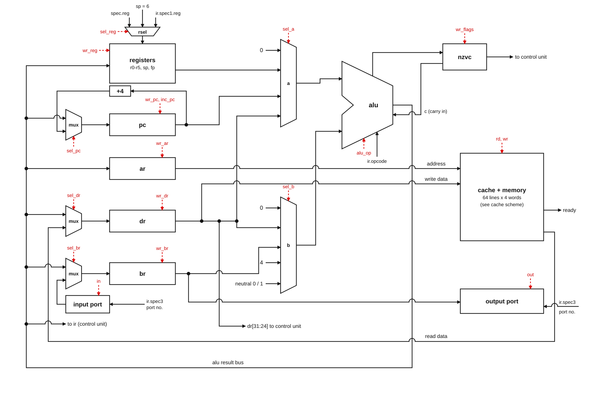
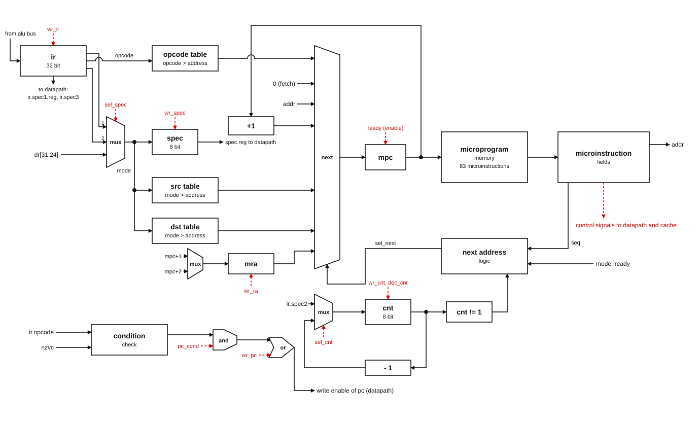
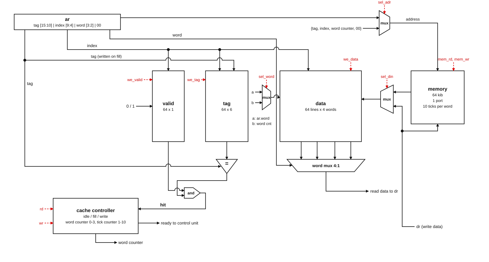

# Лабораторная работа №4. Эксперимент

- Паночко Антон Васильевич, P3211
- Вариант:

```text
lisp | cisc | neum | mc | stream | port | pstr | cache | alg3
```

Реализация на Go (согласовано с преподавателем), только стандартная библиотека, без многопоточности.

## Язык программирования

### Синтаксис

```ebnf
program  ::= { form }
form     ::= defun | expr
defun    ::= "(" "defun" symbol "(" { symbol } ")" expr { expr } ")"
expr     ::= number | char | string | symbol | list
list     ::= "(" "setq" symbol expr ")"
           | "(" "if" expr expr [ expr ] ")"
           | "(" "while" expr { expr } ")"
           | "(" "progn" { expr } ")"
           | "(" "let" "(" { "(" symbol expr ")" } ")" { expr } ")"
           | "(" "array" number ")"
           | "(" operator { expr } ")"
           | "(" symbol { expr } ")"          ; вызов функции
operator ::= "+" | "-" | "*" | "/" | "mod" | "mulh" | "shr"
           | "logand" | "logior" | "logxor"
           | "=" | "/=" | "<" | "<=" | ">" | ">=" | "and" | "or" | "not"
           | "load" | "store" | "add64" | "sub64" | "read-char" | "print-char"
number   ::= [ "-" ] digit { digit } | "0x" hexdigit { hexdigit }
char     ::= "#\\" ( symbolchar | "newline" | "space" | "tab" )
string   ::= '"' { stringchar | "\\n" | '\\"' | "\\\\" } '"'
comment  ::= ";" { any } newline
```

### Семантика

- **Стратегия вычислений:** строгая (call-by-value), аргументы вычисляются слева направо. `if`, `and`, `or` вычисляют только нужные ветви.
- **Всё является выражением** и имеет значение:
  - `setq` и `store` возвращают присвоенное значение;
  - `if` без третьего аргумента в ложной ветви даёт 0;
  - `progn`, `let` и функция возвращают значение последнего выражения;
  - `while` возвращает значение тела на последней итерации или 0;
  - `and` возвращает 0 или значение последнего аргумента, `or` — первое ненулевое значение или 0;
  - сравнения и `not` возвращают 1 или 0.
- **Области видимости:** лексические. Локальные — параметры функции и имена из `let` (связывает последовательно, как `let*`). Любое другое имя, которому есть `setq`, — глобальная переменная с начальным значением 0.
- **Типизация:** отсутствует, всё есть 32-битное слово. Число, символ и адрес не различаются, границы массивов не проверяются.
- **Литералы:** целые (десятичные и `0x`), символьные (`#\a`), строковые (значение — адрес `pstr`).
- **Функции:** только на верхнем уровне, рекурсия поддерживается, функции не являются значениями.
- `(+ a b c …)` и `(* a b c …)` принимают до 255 аргументов.

| Примитив | Действие |
|---|---|
| `(array N)` | адрес статического массива из `N` слов, `N` — литерал |
| `(load a)`, `(store a v)` | чтение и запись слова по адресу |
| `(add64 d s)`, `(sub64 d s)` | 64-битные `d ← d ± s`, аргументы — адреса пар `[младшее, старшее]`; возвращает `d` |
| `(mulh a b)` | старшие 32 бита беззнакового произведения |
| `(read-char)`, `(print-char c)` | ввод и вывод байта |

Библиотека на самом языке ([prelude.lisp](internal/translator/prelude.lisp)): `print-str`, `read-line`, `read-int`, `print-int`, `print-hex`. В бинарный файл попадают только вызванные функции.

`read-int` поглощает разделитель после числа, поэтому за последним числом во вводе нужен перевод строки.

## Организация памяти

```text
       Регистры                      Память (64 КиБ, общая, фон Нейман)
+----------------------+        +----------------------------------+
| R0     результат     |        | 0000 : код main, затем halt      |
| R1     второй операнд|        |      : код функций               |
| R2-R5  свободны      |        |      : глобальные переменные     |
| SP     вершина стека |        |      : строки pstr и массивы     |
| FP     кадр функции  |        |              ...                 |
+----------------------+        |      : стек (растёт вниз)        |
                                | FFFF :                           |
                                +----------------------------------+
```

| Объект | Где находится и как используется |
|---|---|
| Числовой и символьный литерал | прямо в инструкции (непосредственная адресация), отдельной ячейки нет |
| Строковый литерал | секция данных, `pstr`: длина, затем по символу в слове; в инструкции — адрес |
| Массив `(array N)` | секция данных, `N` нулевых слов; каждое вхождение в тексте — отдельный массив |
| Константы | отдельной конструкции нет, используются литералы |
| Глобальная переменная | статическая память, абсолютная адресация `[addr]` |
| Параметр | стек, `[fp+8+4*(n-1-i)]` |
| Локальная переменная `let` | стек, `[fp-4*k]`; место резервируется в прологе |
| Временные значения | `R0`, `R1`; при вложенных выражениях сохраняются на стек |
| Процедуры | после `main`; вызов `call`/`ret`, результат в `R0` |
| Прерывания | нет (вариант `stream`) |

Переменные на регистры не отображаются: регистры нужны только для вычисления выражений, поэтому нехватки регистров не бывает.

Кадр функции (аргументы кладутся слева направо, снимает их вызывающая сторона):

```text
[fp+8+4*(n-1)]  аргумент 0
[fp+8]          аргумент n-1
[fp+4]          адрес возврата
[fp+0]          старый FP
[fp-4] ...      локальные переменные
ниже            временные значения
```

### Отображение выражений

CISC-команды берут «простые» операнды (литерал, переменную) прямо из инструкции или памяти:

| Исходный код | Машинный код |
|---|---|
| `(+ x 5)` | `mov [x], r0` · `add #5, r0` |
| `(+ a (f))` | вычислить `a` в `r0` · `push r0` · вычислить `(f)` · `mov r0, r1` · `pop r0` · `add r1, r0` |
| `(setq x (+ x y))` | `add y, x` (приёмник в памяти) · `mov x, r0` |
| `(+ a b c)` | `addn r0, 3, a, b, c` |
| `(+ (f) (g) (h))` | три `push`, затем `addn r0, 3, [sp+8], [sp+4], [sp+0]` |
| `(add64 d s)` | `add [r1], [r0]` · `adc [r1+4], [r0+4]` |

## Система команд

Архитектура CISC: инструкции переменной длины, арифметика напрямую с памятью, микрокодовый Control Unit.

### Машинное слово и память

- Слово 32 бита, адресация байтовая, порядок байт little-endian, обращения выровнены по 4 байта.
- Фон Нейман: общая однопортовая память 64 КиБ для кода и данных.
- Размещение: код с адреса `0`, за ним статические данные, стек растёт вниз от конца памяти.
- Строки `pstr`: слово длины, затем по одному символу в слове.

### Регистры

| Регистр | Код | Назначение |
|---|---|---|
| `R0`–`R5` | 0–5 | общего назначения |
| `SP` | 6 | указатель стека |
| `FP` | 7 | указатель кадра |
| `PC` | – | счётчик команд |
| `IR` | – | заголовок текущей инструкции |
| `AR` | – | адрес обращения к памяти |
| `DR` | – | данные памяти |
| `BR` | – | буфер операнда-источника |
| `SPEC` | – | описатель разбираемого операнда (8 бит) |
| `CNT` | – | счётчик операндов `addn`/`muln` |
| `NZVC` | – | флаги |

### Формат инструкции

```
 31      24 23      16 15       8 7        0
+----------+----------+----------+----------+
|  opcode  |  spec1   |  spec2   |  spec3   |   + 0..N слов расширения
+----------+----------+----------+----------+
spec = режим (4 бита) | регистр (4 бита)
```

- `spec1` — источник, `spec2` — приёмник, `spec3` — номер порта.
- Слова расширения идут в порядке операндов: сначала источника, потом приёмника.

| Код | Режим | Запись | Слово расширения |
|---|---|---|---|
| 0 | нет операнда | | нет |
| 1 | регистр | `r1` | нет |
| 2 | непосредственный | `#5` | значение |
| 3 | абсолютный | `[100]` | адрес |
| 4 | косвенный | `[r1]` | нет |
| 5 | база + смещение | `[fp-4]` | смещение со знаком |

### Инструкции

| Opcode | Мнемоника | Действие |
|---|---|---|
| `00` | `halt` | остановка |
| `01` | `mov src, dst` | `dst ← src` |
| `02` | `add src, dst` | `dst ← dst + src` |
| `03` | `adc src, dst` | `dst ← dst + src + C` |
| `04` | `sub src, dst` | `dst ← dst - src` |
| `05` | `sbc src, dst` | `dst ← dst - src - C` (`C` — заём) |
| `06` | `mul src, dst` | младшие 32 бита произведения |
| `07` | `mulh src, dst` | старшие 32 бита беззнакового произведения |
| `08` | `div src, dst` | `dst ← dst / src` (со знаком) |
| `09` | `mod src, dst` | остаток `dst / src` |
| `0A` | `and src, dst` | побитовое И |
| `0B` | `or src, dst` | побитовое ИЛИ |
| `0C` | `xor src, dst` | исключающее ИЛИ |
| `0D` | `cmp src, dst` | флаги по `dst - src` |
| `0E` | `addn rd, N, a1…aN` | `rd ← a1 + … + aN` |
| `0F` | `muln rd, N, a1…aN` | `rd ← a1 · … · aN` |
| `10` | `jmp src` | `PC ← src` |
| `11` | `jz src` | переход при `Z` |
| `12` | `jnz src` | переход при `!Z` |
| `13` | `jl src` | переход при `N ≠ V` |
| `14` | `jle src` | переход при `Z` или `N ≠ V` |
| `15` | `jg src` | переход при `!Z` и `N = V` |
| `16` | `jge src` | переход при `N = V` |
| `17` | `jc src` | переход при `C` |
| `18` | `call src` | `push PC; PC ← src` |
| `19` | `ret` | `pop PC` |
| `1A` | `push src` | `SP ← SP - 4; [SP] ← src` |
| `1B` | `pop dst` | `dst ← [SP]; SP ← SP + 4` |
| `1C` | `in port, dst` | `dst ← port` |
| `1D` | `out src, port` | `port ← src` |
| `1E` | `shr src, dst` | логический сдвиг `dst` вправо на `src` |

Арифметика ставит все флаги `NZVC`, логические операции, умножение и деление сбрасывают `V` и `C`; `mov` и переходы флаги не меняют. Приёмник не может быть непосредственным. Порты: `0` — ввод, `1` — вывод. При чтении из пустого ввода моделирование останавливается.

### Кодирование `addn` и `muln`

В заголовке: `spec1` — регистр-приёмник, `spec2` — число операндов `N` (1–255). Далее для каждого операнда идёт слово-описатель (`spec` в старшем байте) и, если нужно по режиму, слово расширения. Регистр-приёмник не может участвовать в операндах (проверяет транслятор).

### Примеры кодирования

| Инструкция | Машинные слова |
|---|---|
| `add r1, r2` | `02111200` |
| `add [fp-4], r1` | `02571100 FFFFFFFC` |
| `addn r0, 3, r1, #5, [fp-4]` | `0E100300 11000000 20000000 00000005 57000000 FFFFFFFC` |

### Такты

Одна микроинструкция занимает один такт, пока не ждёт память. В таблицах ниже каждое обращение к памяти посчитано за 1 такт: каждый промах чтения добавляет ещё 40 тактов, каждая запись — ещё 9. Числа проверяются тестом `internal/machine/machine_test.go`.

**Выборка заголовка:** 3 такта (`AR←PC`; `DR←mem[AR], PC←PC+4`; `IR←DR`).

**Разбор операнда:** 1 такт на загрузку `SPEC`, затем:

| Режим | Значение источника в `BR` | Адрес приёмника в `AR` |
|---|---|---|
| регистр | 1 | 0 |
| непосредственный | 3 | – |
| абсолютный | 5 | 3 |
| косвенный | 3 | 1 |
| база + смещение | 5 | 3 |

**Исполнение:**

| Инструкции | Такты после разбора операндов |
|---|---|
| АЛУ-операции | приёмник регистр: 1; память: 3 |
| `mov` | регистр: 1; память: 2 |
| `cmp` | регистр: 1; память: 2 |
| переходы | 1 (не зависит от того, выполнен ли переход) |
| `call` | 5 |
| `ret` | 4 |
| `push` | 4 |
| `pop` | 4 до разбора приёмника, затем как `mov` |
| `in` | 1 до разбора приёмника, затем как `mov` |
| `out` | 1 |
| `halt` | 1 |

**`addn` / `muln`:** `3 + 2 + Σ(5 + t_src)`, где `t_src` — число из столбца источника.

| Пример | Расчёт | Такты |
|---|---|---|
| `add r1, r2` | 3 + (1+1) + (1+0) + 1 | 7 |
| `add [fp-4], r1` | 3 + (1+5) + (1+0) + 1 | 11 |
| `add r1, [fp-4]` | 3 + (1+1) + (1+3) + 3 | 12 |
| `jmp #label` | 3 + (1+3) + 1 | 8 |
| `addn r0, 3, r1, #5, [fp-4]` | 3 + 2 + 6 + 8 + 10 | 29 |

### Кэш

- Общий для команд и данных, прямого отображения, 64 строки по 4 слова (1 КиБ).
- Адрес: `tag [15:10] \| index [9:4] \| word [3:2] \| 00`.
- Попадание при чтении: 1 такт.
- Промах при чтении: 40 тактов на загрузку строки (10 на слово), затем 1 такт чтения.
- Запись: write-through без аллокации, всегда 10 тактов. При попадании обновляется и строка кэша.

### Почему кэш 64 строки

Первоначально было 16 строк (256 байт). Код крупных программ занимает 1–2,5 КиБ и вместе со стеком вытеснял сам себя: `sort`, `power_many`, `glob_match` и `linear_filter` работали **медленнее**, чем без кэша (например, `sort`: 101 527 тактов против 92 262). Промах стоит 41 такт против 10 без кэша, поэтому кэш выгоден только при доле промахов меньше 22,5 % (`1 + 40·m < 10`). С 64 строками выигрывают все программы.

## Транслятор

```sh
go run ./cmd/translator <source.lisp> <target.bin>
```

Создаёт бинарный образ памяти `target.bin` (слова little-endian: код, затем данные) и листинг `target.bin.lst` строками `<address> - <HEXCODE> - <mnemonic> ; <исходное выражение>`.

Этапы:

1. [parser.go](internal/translator/parser.go): текст в дерево S-выражений.
2. [translator.go](internal/translator/translator.go): сбор функций и глобальных переменных.
3. [codegen.go](internal/translator/codegen.go): обход дерева, инструкции с метками вместо адресов. Начинается с `main`, вызванные функции добавляются в очередь.
4. Компоновка: адреса меток, раскладка данных после кода, кодирование. Длина инструкции не зависит от значения адреса, поэтому хватает двух проходов.

## Модель процессора

```sh
go run ./cmd/machine [флаги] <code.bin> [input.txt]
```

| Флаг | Назначение |
|---|---|
| `-log file` | журнал тактов |
| `-head N`, `-tail N` | сохранить только первые и последние `N` тактов |
| `-limit N` | лимит тактов |
| `-no-cache` | отключить кэш для сравнения |
| `-microcode` | напечатать память микропрограмм |

Вывод программы идёт в stdout, итоги (такты, статистика кэша) — в stderr. Если рядом с `code.bin` есть `code.bin.lst`, в журнале появляются исходные выражения. Моделирование останавливается по `halt` или при чтении из пустого ввода.

Метод `Machine.Tick()` выполняет ровно один такт, поэтому моделирование можно остановить на любом из них.

### Обозначения на схемах

Чёрные сплошные линии — данные и адреса, красные пунктирные — управляющие сигналы из Control Unit. Точка — соединение проводов, дуга — провода пересекаются без соединения. Одинаковые подписи на концах проводов означают связь между схемами или частями схемы.

### DataPath



Перенос из `NZVC` идёт обратно в АЛУ для `adc` и `sbc`. Номер порта берётся из `IR.spec3`. Операция АЛУ и нейтральный элемент (0 для `addn`, 1 для `muln`) определяются опкодом в `IR`.

### Control Unit



Пока память не готова (`ready = 0`), `mPC` и все регистры не защёлкиваются: процессор остаётся на той же микрокоманде. `PC` записывается по сигналу `wr_pc` либо по `pc_cond`, если выполнено условие перехода.

### Кэш



Попадание занимает 1 такт. Промах чтения: 4 слова по 10 тактов (40), затем попадание. Запись всегда занимает 10 тактов; строка обновляется только при попадании (write-through без аллокации).

### Сигналы

| Сигнал | Поле микрокоманды | Действие |
|---|---|---|
| `sel_a` | `a` | левый вход АЛУ: 0, регистр, `PC`, `DR` |
| `sel_b` | `b` | правый вход АЛУ: 0, `BR`, `DR`, 4, нейтральный элемент (0 для `addn`, 1 для `muln`) |
| `alu_op` | `alu` | сложение, вычитание или операция по опкоду из `IR` |
| `sel_reg` | `reg` | номер регистра: `SPEC.reg`, `SP`, `IR.spec1.reg` |
| `wr_reg`, `wr_ar`, `wr_ir`, `wr_flags` | `latch` | защёлки регистров |
| `wr_dr`, `wr_br` | `latch` | защёлки `DR`, `BR` |
| `sel_dr`, `sel_br` | `dr` | источник: АЛУ, память или порт |
| `wr_pc`, `inc_pc`, `sel_pc` | `latch` | `PC` из АЛУ или `PC+4` |
| `pc_cond` | `latch` | записать `PC`, если выполнено условие опкода |
| `sel_spec`, `wr_spec` | `spec`, `latch` | загрузка `SPEC` |
| `sel_cnt`, `wr_cnt`, `dec_cnt` | `latch` | загрузка и декремент `CNT` |
| `rd`, `wr` | `mem` | обращение к кэшу |
| `out` | `out` | вывод `BR` в порт |
| `in` | `dr` | забрать очередной байт из порта ввода |
| `sel_next`, `wr_ra` | `seq` | выбор следующего `mPC`, запись `mRA` |

Сигналы внутри кэша (`sel_adr`, `sel_din`, `sel_word`, `we_data`, `we_tag`, `we_valid`, `mem_rd`, `mem_wr`) формирует контроллер кэша.

### Микрокод

Микропрограммы лежат в отдельной памяти ([microcode.go](internal/machine/microcode.go)), модель на каждом такте читает микрокоманду по `mPC` и интерпретирует её поля. Формат микрокоманды (38 бит):

| Поле | `a` | `b` | `alu` | `latch` | `reg` | `spec` | `dr` | `mem` | `out` | `seq` | `addr` |
|---|---|---|---|---|---|---|---|---|---|---|---|
| Бит | 2 | 3 | 2 | 12 | 2 | 2 | 2 | 2 | 1 | 3 | 7 |

`latch` кодируется унитарно (по биту на сигнал). В модели поля хранятся структурой Go, без упаковки в биты.

| `seq` | Следующий адрес |
|---|---|
| next | `mPC+1` |
| jump | `addr` |
| by opcode | таблица опкодов |
| call src | таблица режимов источника, `mRA ← mPC+1` |
| dst | регистр: `mPC+1`; иначе таблица режимов приёмника, `mRA ← mPC+2` |
| return | `mRA` |
| cnt loop | `addr`, пока `CNT ≠ 0` после декремента, иначе 0 |
| halt | останов |

Приём в `dst`: следом за такой микрокомандой лежит запись в регистр (`mPC+1`), а за ней — путь через память (`mPC+2`). Отдельный такт на проверку «приёмник регистр или память» не тратится.

Пока память не готова, `mPC` и регистры не защёлкиваются.

Полный листинг и таблицы диспетчеризации ([docs/microcode.txt](docs/microcode.txt)):

<details>
<summary>Память микропрограмм</summary>

```text
00  AR<-PC                     next
01  DR<-mem[AR], PC<-PC+4      next
02  IR<-DR                     by opcode
03  BR<-reg                    return
04  AR<-PC                     next
05  DR<-mem[AR], PC<-PC+4      next
06  BR<-DR                     return
07  AR<-PC                     next
08  DR<-mem[AR], PC<-PC+4      next
09  AR<-DR                     next
10  DR<-mem[AR]                next
11  BR<-DR                     return
12  AR<-reg                    next
13  DR<-mem[AR]                next
14  BR<-DR                     return
15  AR<-PC                     next
16  DR<-mem[AR], PC<-PC+4      next
17  AR<-reg+DR                 next
18  DR<-mem[AR]                next
19  BR<-DR                     return
20  AR<-PC                     next
21  DR<-mem[AR], PC<-PC+4      next
22  AR<-DR                     return
23  AR<-reg                    return
24  AR<-PC                     next
25  DR<-mem[AR], PC<-PC+4      next
26  AR<-reg+DR                 return
27  SPEC<-IR.spec1             call src
28  SPEC<-IR.spec2             dst
29  reg<-reg op BR             jump 00
30  DR<-mem[AR]                next
31  DR<-DR op BR               next
32  mem[AR]<-DR                jump 00
33  SPEC<-IR.spec1             call src
34  SPEC<-IR.spec2             dst
35  NZVC<-reg-BR               jump 00
36  DR<-mem[AR]                next
37  NZVC<-DR-BR                jump 00
38  SPEC<-IR.spec1             call src
39  SPEC<-IR.spec2             dst
40  reg<-BR                    jump 00
41  DR<-BR                     next
42  mem[AR]<-DR                jump 00
43  CNT<-IR.spec2              next
44  rd<-neutral                next
45  AR<-PC                     next
46  DR<-mem[AR], PC<-PC+4      next
47  SPEC<-DR[31:24]            call src
48  rd<-rd op BR               next
49  CNT<-CNT-1                 cnt loop 45
50  SPEC<-IR.spec1             call src
51  if cond: PC<-BR            jump 00
52  SPEC<-IR.spec1             call src
53  SP<-SP-4                   next
54  AR<-SP                     next
55  DR<-PC                     next
56  mem[AR]<-DR                next
57  PC<-BR                     jump 00
58  AR<-SP                     next
59  DR<-mem[AR]                next
60  PC<-DR                     next
61  SP<-SP+4                   jump 00
62  halt                       halt
63  SPEC<-IR.spec1             call src
64  SP<-SP-4                   next
65  AR<-SP                     next
66  DR<-BR                     next
67  mem[AR]<-DR                jump 00
68  AR<-SP                     next
69  DR<-mem[AR]                next
70  BR<-DR                     next
71  SP<-SP+4                   next
72  SPEC<-IR.spec2             dst
73  reg<-BR                    jump 00
74  DR<-BR                     next
75  mem[AR]<-DR                jump 00
76  BR<-port                   next
77  SPEC<-IR.spec2             dst
78  reg<-BR                    jump 00
79  DR<-BR                     next
80  mem[AR]<-DR                jump 00
81  SPEC<-IR.spec1             call src
82  port<-BR                   jump 00

opcode -> mPC:
  halt  62
  mov   38
  add   27
  adc   27
  sub   27
  sbc   27
  mul   27
  mulh  27
  div   27
  mod   27
  and   27
  or    27
  xor   27
  cmp   33
  addn  43
  muln  43
  jmp   50
  jz    50
  jnz   50
  jl    50
  jle   50
  jg    50
  jge   50
  jc    50
  call  52
  ret   58
  push  63
  pop   68
  in    76
  out   81
  shr   27

mode -> mPC (src, dst):
  reg    03  -
  imm    04  -
  abs    07  20
  ind    12  23
  based  15  24
```

</details>

## Тестирование

Golden-тест — один YAML-файл: исходный код, ввод, машинный код с мнемониками и данными, вывод, итоговые показатели и журнал. Код и данные лежат в общей памяти, в `out_code` они разделены на `# code` и `# data`. Журнал урезан до начала и конца работы.

| Тест | Что показывает |
|---|---|
| [hello](golden/hello.yml) | статическая `pstr`, вывод через порт |
| [cat](golden/cat.yml) | бесконечный ввод, останов по пустому буферу |
| [hello_user_name](golden/hello_user_name.yml) | чтение строки в массив |
| [sort](golden/sort.yml) | ввод списка чисел с длиной, сортировка вставками |
| [double_precision](golden/double_precision.yml) | `add`+`adc`, `sub`+`sbc`, `mulh`, 20! |
| [power_many](golden/power_many.yml) | алгоритм варианта, переполнение даёт `0xCCCCCCCC` |
| [glob_match](golden/glob_match.yml) | алгоритм варианта, рекурсия с возвратом |
| [linear_filter](golden/linear_filter.yml) | работа кэша: промахи, попадания, ожидание в журнале |
| [expressions](golden/expressions.yml) | особенности `lisp` и `cisc`: всё выражение, рекурсия, `addn`, `muln` |

Дополнительно [machine_test.go](internal/machine/machine_test.go) проверяет такты инструкций и тайминги кэша.

```sh
go test ./...          # проверка
go test -update .      # перезаписать эталоны после намеренных изменений
```

CI ([ci.yml](.github/workflows/ci.yml)): `gofmt`, `golangci-lint` со всеми линтерами (отключения обоснованы в [.golangci.yml](.golangci.yml)), тесты с покрытием. Автоформаттера для собственного Lisp нет, исходники в `examples/` отформатированы вручную.

### Влияние кэша

| Программа | Такты с кэшем | Без кэша | Ускорение | Доля промахов чтения |
|---|---|---|---|---|
| hello | 3616 | 7609 | 2.10× | 3.9 % |
| cat | 1060 | 2273 | 2.14× | 3.2 % |
| hello_user_name | 12415 | 25477 | 2.05× | 4.3 % |
| sort | 67447 | 92262 | 1.37× | 12.6 % |
| double_precision | 33936 | 74110 | 2.18× | 2.9 % |
| power_many | 72745 | 127711 | 1.76× | 7.5 % |
| glob_match | 31595 | 52736 | 1.67× | 7.9 % |
| linear_filter | 38576 | 64531 | 1.67× | 7.7 % |
| expressions | 160606 | 247444 | 1.54× | 9.4 % |

## Пример использования

```console
$ go run ./cmd/translator examples/hello_user_name.lisp hello.bin
$ go run ./cmd/machine -log run.log hello.bin examples/hello_user_name.txt
What is your name?
Hello, Alice!

stop: halt
...
```
